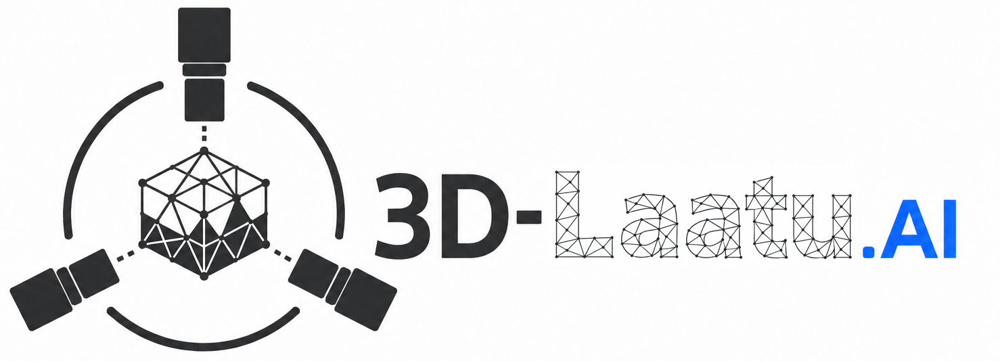
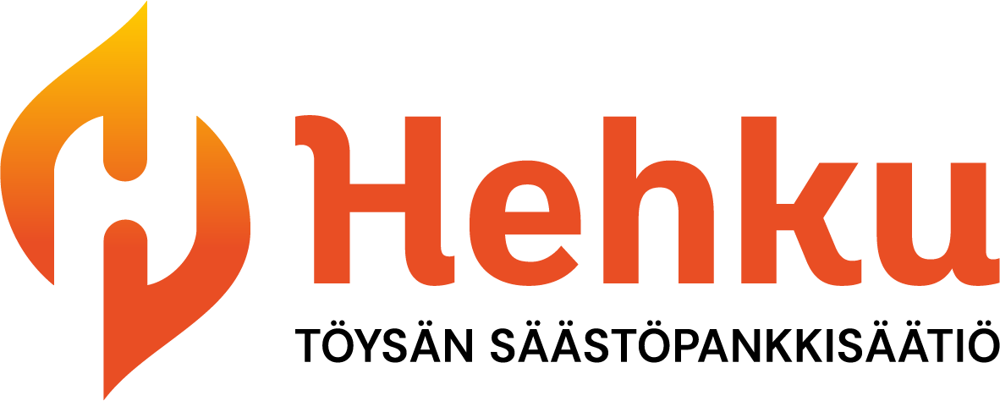
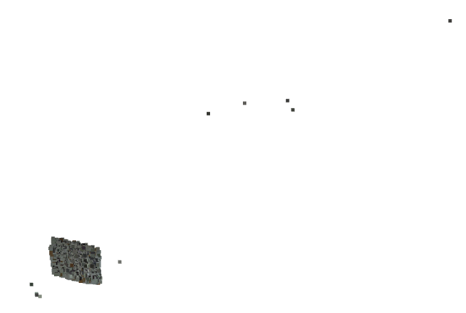
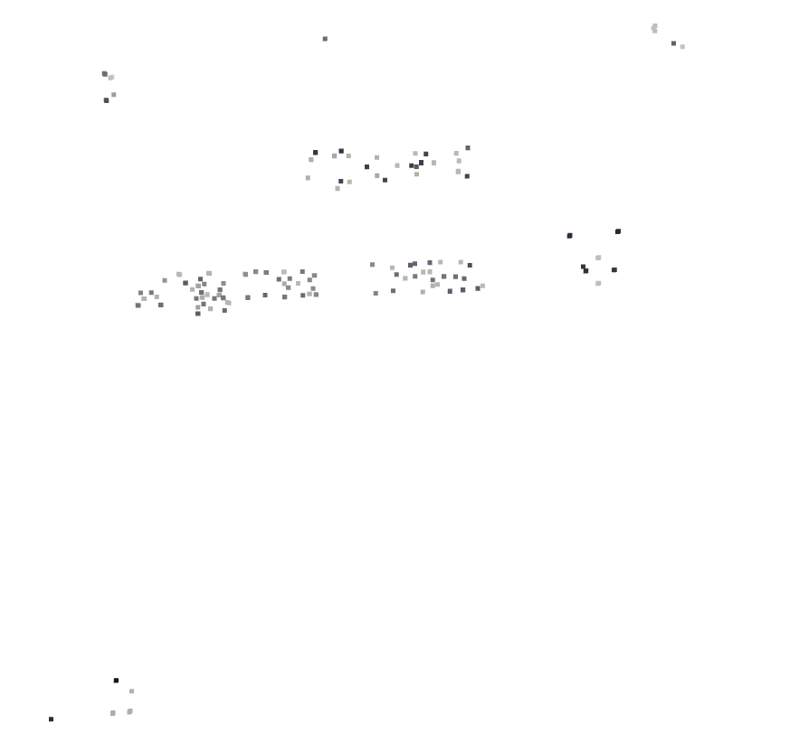
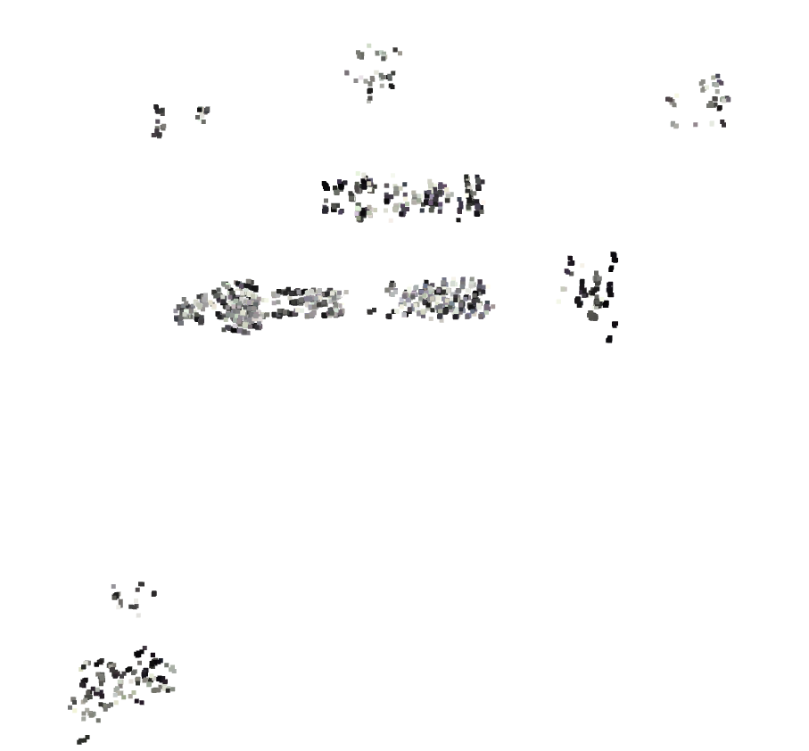
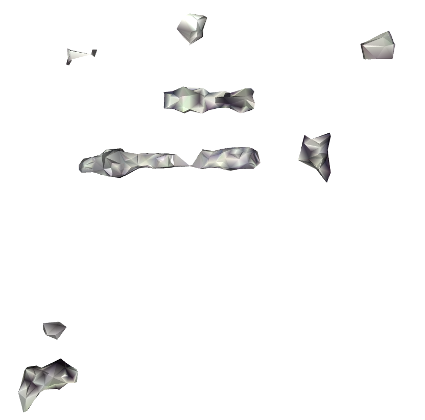
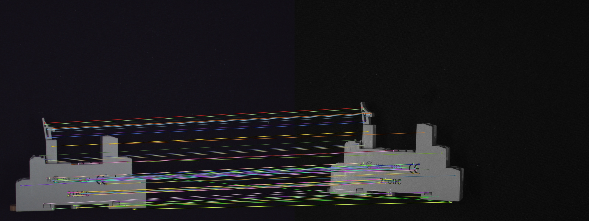

# Close-Range Photogrammetry: Multi-Camera Close-Range Photogrammetry Pipeline





This project contains a modular Python pipeline for close-range photogrammetry using multiple synchronized cameras and OpenCV-based calibration and reconstruction methods.

The pipeline supports:

- intrinsic camera calibration
- stereo/extrinsic calibration
- sparse 3D reconstruction from synchronized image sets
- sparse point cloud filtering
- mesh generation from filtered point clouds
- dense stereo reconstruction and multi-position surface fusion
- comparison against scanner reference measurements
- debugging and visualization tools

The project has been tested with:

- Python 3.11.9

## Source layout and main commands

The processing code is in `pipeline/`. Supporting programs are grouped by
purpose under `tools/`:

```text
pipeline/
  run_dense_laser_pipeline.py          # dense reconstruction entrypoint
  run_laser_reference_comparison.py    # reference comparison entrypoint
  ...                                 # processing, export and required checks
tools/
  baselines/                          # earlier calibration and sparse experiments
  diagnostics/                        # synchronization and orientation investigations
  visualization/                      # model collections and orbit animations
  validation/                         # additional import and output checks
  experimental/                       # experimental visual-hull workflows
calibration_files/                    # October camera calibration JSON files
project_config.example.yaml
README.md and workflow guides
```

Run commands from the project root, after installing the dependencies and
restoring the inputs described in the workflow guides:

```powershell
.venv/Scripts/python.exe -u pipeline/run_dense_laser_pipeline.py
.venv/Scripts/python.exe pipeline/run_laser_reference_comparison.py
```

The dense workflow includes its geometry and Blender verification steps. These
required checks remain in `pipeline/`; `tools/validation/` contains additional
checks such as `tools/validation/test_reference_import.py`. The two main
entrypoints do not run every supporting program under `tools/`.

The source folders do not change the data layout: image sets, scanner exports,
calibration files and generated results keep their existing locations in the
project root. The workflow guides below describe the prerequisites and any
additional export steps.

The layout and cache compatibility checks can be run without rebuilding models:

```powershell
.venv/Scripts/python.exe -m unittest discover -s tests -v
```

Checks against saved dense/laser results run when the local datasets are present
and leave the saved reports unchanged; they are skipped in a source-only clone.
The relocation manifest in `pipeline/source_relocations.json` preserves existing
cache compatibility only for the exact audited source versions. Later algorithm
changes invalidate old caches; do not update the manifest just to bypass that
check.

## Dense reconstruction and reference measurements

The project also includes separate workflows for dense reconstruction and
comparison against scanner reference measurements:

| Workflow | Entrypoint | Documentation |
| --- | --- | --- |
| Dense stereo, multi-position fusion, Blender export and verification | `pipeline/run_dense_laser_pipeline.py` | [Dense pipeline](DENSE_PIPELINE.md) |
| Laser scanner reference import, alignment and comparison | `pipeline/run_laser_reference_comparison.py` | [Laser reference comparison](LASER_REFERENCE_COMPARISON.md) |
| Earlier profile-scanner reference comparison | `pipeline/compare_profile_reference.py` | [Profile comparison](PROFILE_COMPARISON.md) |
| Calibration and sparse reconstruction checks | `tools/baselines/run_calibration_baseline.py`, `tools/baselines/run_sparse_baseline.py` | [Calibration baseline](CALIBRATION_BASELINE.md), [Sparse baseline](SPARSE_BASELINE.md) |
| Full sparse sequence, filtering and registration | `tools/baselines/run_full_pipeline.py` | [Full pipeline](FULL_PIPELINE.md) |

The dense and reference workflows have their own processing, export and
verification scripts; they share calibration and reconstruction helpers.
See the linked guides for inputs, options and interpretation limits.

### Data and generated files

Git contains the source code, documentation, four calibration JSON files in
`calibration_files/`, and `LaserScans/reference_pairings.json` with the reference
surface interpretation settings. The calibration files describe the October
2026 camera setup; reuse requires unchanged camera geometry and focus.

Raw image sets (`2026-05-07/`, `2026-05-19/`, `2026-10-29/`), profile and laser
scanner data, generated point clouds and results, `3D_models/`, `Animaatiot_4K/`,
`videot/`, `0_PAPER/`, logs and the local Python environment are excluded by
`.gitignore`. These files remain on the local machine and must be shared
separately when needed. Scripts that create animations are included; rendered
animations and videos are excluded. Links to generated figures or models in the
guides resolve only when the corresponding local data/results are present.

A fresh clone needs the external inputs before running the pipelines:

- For the October dense/laser workflows, restore camera captures under
  `2026-10-29/` and scanner exports under `LaserScans/`. The earlier Basler
  baselines use the separate May datasets and `Profile scanner reference/`.
- The dense workflow starts from the sparse baseline, including
  `laser_results/run_report.json`, `fusion_report.json`, `leveling_report.json`
  and frame point clouds. Restore these under `2026-10-29/`, or generate them
  in order with `pipeline/run_laser_validation.py`, `pipeline/prepare_laser_leveling.py` and
  `pipeline/merge_laser_threepiece.py`, before running `pipeline/run_dense_laser_pipeline.py`.
- The reference comparison requires the dense models and the scanner exports.
  Follow [the comparison guide](LASER_REFERENCE_COMPARISON.md) for import and
  comparison commands. The import tests in `tools/validation/` also
  require the local scanner exports and converted reference files.
- Create your local `project_config.yaml` from `project_config.example.yaml`
  for the configurable calibration and sparse workflows, then enable the
  runner-specific sections described below. The local config is ignored by
  Git. Blender export requires Blender; the dense wrapper accepts
  `--blender PATH` to override its Windows default.

### Baseline runner configuration

The sections for the additional `run_*` baseline scripts are commented out in
`project_config.example.yaml`. Copying the file and changing only `img_root`
is insufficient: uncomment each required section and its settings, preserving
YAML indentation, and select the object, frames and output folders for your data.
Missing sections cause a `KeyError` when the corresponding runner starts.

These workflows also use the shared dataset settings in `project_config.yaml`
as needed. The table lists the additional top-level sections each entrypoint
reads; processing stages still require the outputs of the earlier stages.

| Entrypoint | Additional configuration sections |
| --- | --- |
| `tools/baselines/run_sparse_baseline.py` | `sparse_baseline` |
| `tools/baselines/run_filter_baseline.py` | `sparse_baseline`, `filter_baseline` |
| `tools/baselines/run_sequence_baseline.py` | `sparse_baseline`, `filter_baseline`, `sequence_baseline` |
| `tools/baselines/run_registration_baseline.py` | `sequence_baseline`, `registration_baseline` |
| `tools/baselines/run_registered_filter.py` | `sequence_baseline`, `registered_filter` |
| `tools/baselines/run_full_pipeline.py` | `sparse_baseline`, `filter_baseline`, `full_sequence`, `registration_baseline`, `registered_filter` |
| `pipeline/compare_profile_reference.py` | `full_sequence`, `profile_comparison` |

`tools/baselines/run_full_pipeline.py` reconstructs, registers and filters the full sequence.
Run `pipeline/compare_profile_reference.py` separately afterwards for the green-object
profile comparison. `tools/baselines/run_gray_validation.py` runs both stages; it uses the
same sparse/filter/registration sections, `gray_full_sequence` instead of
`full_sequence`, and `gray_profile_comparison`. The marked-gray wrapper uses
`marked_gray_full_sequence` and `marked_gray_profile_comparison` instead.
Set each comparison's `reference_csv` to the matching external scanner file.

The baseline guides describe specific runs on the May camera setup (Basler
60gc/60gm). They do not use the October Basler 96/07 calibration JSON files in
the repository root. Restore or generate the calibration belonging to your
dataset. To reproduce the May calibration, follow the dataset-specific folder
and synchronization settings in [the calibration guide](CALIBRATION_BASELINE.md).
The documented 15-frame sequence pilot uses frame keys 1 through 15; the example
contains only 1 through 3, while `frame_keys: all` selects the entire sequence.

The dated baseline and comparison tables report saved experimental runs; a new
run with different inputs or settings is not expected to reproduce those values.

---

## Features

- Multi-camera support
- OpenCV-based calibration
- Feature-based sparse triangulation (SIFT / ORB)
- Point-cloud filtering with Open3D
- Mesh generation (Alpha Shape / Ball Pivoting / Poisson)
- VS Code friendly workflow
- Debugging support for:
  - camera pairs
  - individual frames
  - feature matching visualization

---

## Installation

### 1. Create a Python virtual environment

#### Windows

```bash
python -m venv .venv
````

Activate:

```bash
.venv\Scripts\activate
```

#### Linux / macOS

```bash
python3 -m venv .venv
```

Activate:

```bash
source .venv/bin/activate
```

---

### 2. Install dependencies

Install all required packages using:

```bash
pip install -r requirements.txt
```

---

## Expected Image Data Structure

The following folder, filename and execution-order examples describe the
original sparse workflow. Folder and camera names are illustrative and must
match `project_config.yaml`. The October timestamped captures and dense/laser
workflows use the separate setup linked at the top of this README.

```text
img_root/
│
├── chessboards/
│   ├── intrinsics_data_set/
│   │   ├── cam0/
│   │   ├── cam1/
│   │   └── cam2/
│   │
│   └── extrinsics_data_set/
│       ├── cam0/
│       ├── cam1/
│       └── cam2/
│
├── object/
    ├── obj0/
    │   ├── cam0/
    │   ├── cam1/
    │   └── cam2/
    │
    └── obj1/
        ├── cam0/
        ├── cam1/
        └── cam2/


```

---

## Image Naming

For the original sparse workflow, synchronization is based on the filename
prefix before the first underscore. Stereo calibration can additionally apply
the dataset-specific `stereo_sync` offsets described in the calibration guide.
The October laser-capture runner instead groups images by camera serial and
timestamp.

Example:

```text
cam0/1_obj0_xxxx.jpg
cam1/1_obj0_yyyy.jpg
cam2/1_obj0_zzzz.jpg
```

All three images belong to frame `1`.

---

## project_config.yaml

Shared dataset paths, camera definitions and debug selections are configured in:

```text
project_config.yaml
```

This file contains:

* camera names
* checkerboard geometry
* folder names
* reference camera index
* debugging settings

Illustrative excerpt (not a complete runnable configuration). Camera names and
checkerboard dimensions below are placeholders; use the full
`project_config.example.yaml` and the settings verified for your dataset:

```yaml
img_root: "D:/photogrammetry_project"

camera_names:
  - cam0
  - cam1
  - cam2

reference_camera_index: 0

checkerboard:
  board_size: [16, 9]
  square_size: 7.5

folders:
  calibration_files: "calibration_files"
  reconstruction_results: "reconstruction_results"
  filtered_point_clouds: "filtered_point_clouds"
  mesh_results: "mesh_results"

debug:
  enabled: false
  target_camera_indices: null
  frame_keys_to_use: null
```

Copy `project_config.example.yaml`
to:

```text
project_config.yaml
```

and edit the paths, camera definitions and board settings for your dataset.
For the additional baseline runners, also enable the sections listed in
[Baseline runner configuration](#baseline-runner-configuration). Some original
filtering and meshing algorithm settings are still set in the scripts' `main()`
functions rather than in YAML.

---

## Pipeline Execution Order

The scripts should be executed in the following order.

---

### 1. pipeline/calibrate_cam_with_chessboards.py

Performs intrinsic calibration separately for each camera using chessboard images.

Produces:

```text
calibration_files/
  cam0_calibration.json
  cam1_calibration.json
  cam2_calibration.json
```

Contains:

* camera matrix
* distortion coefficients
* reprojection error
* optimized camera matrix

---

### 2. pipeline/calibrate_stereo_with_chessboards.py

Performs stereo/extrinsic calibration between the reference camera and all other cameras.

Produces:

```text
calibration_files/
  extrinsics_result.json
```

Contains:

* rotation matrices
* translation vectors
* stereo reprojection RMS errors

---

### 3. pipeline/reconstruct_sparse_point_cloud.py

Performs sparse 3D reconstruction separately for each synchronized frame.

Steps:

* feature detection
* feature matching
* triangulation
* reprojection filtering

Produces frame-specific sparse point clouds:

```text
reconstruction_results/
  obj0/
    frame_1/
      sparse_point_cloud.npz
      sparse_point_cloud.ply
    frame_2/
      sparse_point_cloud.npz
      sparse_point_cloud.ply
    ...
```

Optional feature matching debug outputs are stored under the corresponding frame:

```text
reconstruction_results/
  obj0/
    frame_1/
      debug/
        feature_matches/
```

---

### 4. pipeline/filter_point_cloud.py

Filters each frame-specific sparse point cloud before frame registration.

Steps:

* NaN and non-finite point removal
* depth filtering
* statistical outlier removal
* optional radius outlier removal
* optional voxel downsampling

Produces:

```text
reconstruction_results/
  obj0/
    frame_1/
      sparse_point_cloud.npz
      sparse_point_cloud.ply
      filtered_point_cloud.npz
      filtered_point_cloud.ply
    frame_2/
      ...
```

The filtered frame clouds are used as input for `pipeline/register_sparse_frames.py`.

Per-frame visualization is optional; the current `main()` sets
`visualize_each=False` for batch processing.



*Original sparse point cloud with lots of outliers*



*Filtered sparse point cloud with outliers removed*

---

### 5. pipeline/register_sparse_frames.py

Registers the filtered frame-specific sparse point clouds into a common coordinate system.

The transformations between frames are estimated using feature correspondences and refined to align the frame reconstructions. The transformed frame clouds are then combined into a single object-level sparse point cloud.

Input:

```text
reconstruction_results/
  obj0/
    frame_1/
      filtered_point_cloud.npz
    frame_2/
      filtered_point_cloud.npz
    ...
```

Produces:

```text
reconstruction_results/
  obj0/
    registered/
      registered_sparse_point_cloud.npz
      registered_sparse_point_cloud.ply
      frame_transforms.json
      registration_report.json
```

Contains:

* registered and combined sparse point cloud
* transformations between frame coordinate systems
* registration quality information



*Registered sparse point cloud combines points from all the views of the object moved to the same coordinate system*

---

### 6. pipeline/filter_registered_point_cloud.py

Filters the combined object-level point cloud produced by frame registration.

This second filtering stage is useful because the registered point cloud contains overlapping observations from multiple object poses.

Steps:

* non-finite point removal
* optional depth filtering
* optional voxel downsampling
* statistical outlier removal
* optional radius outlier removal

Produces:

```text
reconstruction_results/
  obj0/
    registered/
      filtered_registered_point_cloud.npz
      filtered_registered_point_cloud.ply
```

---

### 7. pipeline/mesh_from_registered_point_cloud.py

Creates the final object-level surface mesh from the filtered registered point cloud.

Supported methods:

* alpha shape
* ball pivoting
* Poisson reconstruction

The script estimates the typical nearest-neighbour point spacing of the registered point cloud. Parameters such as the Alpha Shape parameter, Ball Pivoting radii, and normal estimation radius can be defined as multipliers of this estimated spacing.

Produces, depending on the selected method:

```text
reconstruction_results/
  obj0/
    registered/
      prepared_registered_point_cloud.ply
      alpha_registered_mesh.ply
      alpha_registered_mesh.obj
```

For example, when Ball Pivoting or Poisson reconstruction is selected, the mesh filenames reflect the selected method.

Shows also the prepared registered point cloud and the resulting mesh.



*Meshed surface*

---

### Main Pipeline Summary

```text
pipeline/calibrate_cam_with_chessboards.py
        ↓
pipeline/calibrate_stereo_with_chessboards.py
        ↓
pipeline/reconstruct_sparse_point_cloud.py
        ↓
pipeline/filter_point_cloud.py
        ↓
pipeline/register_sparse_frames.py
        ↓
pipeline/filter_registered_point_cloud.py
        ↓
pipeline/mesh_from_registered_point_cloud.py
```

### Frame-Level Mesh Generation

`pipeline/mesh_from_filtered_point_cloud.py` can still be used to generate meshes from individual frame reconstructions. It is useful for debugging and comparing individual frames, but it is not required in the main object-level reconstruction pipeline.

### Experimental Visual Hull Pipeline

The visual hull scripts are currently experimental and **are not part of the main reconstruction pipeline**.

These include:

* `tools/experimental/reconstruct_visual_hull.py`
* `tools/experimental/register_visual_hull_frames.py`
* related visual hull debugging scripts

They are currently used for testing silhouette-based reconstruction and investigating how silhouette information could complement the feature-based sparse reconstruction. They should therefore be considered a separate experimental branch of the project.

---

## Produced File Formats

### .json

Calibration metadata:

* camera matrices
* distortion coefficients
* extrinsics

### .npz

Compressed NumPy point cloud storage:

* xyz coordinates
* RGB colors
* metadata

### .ply

Visualization format supported by:

* Open3D
* CloudCompare
* MeshLab

### .obj

Triangle mesh format.

---

## Debugging

Debugging is controlled through `project_config.yaml`.

Example:

```yaml
debug:
  enabled: true
  target_camera_indices: [2]
  frame_keys_to_use: ["1"]
```

This configuration:

* reconstructs only using camera pair:

  * cam0 → cam2
* reconstructs only frame:

  * 1

This is useful for:

* identifying bad camera pairs
* debugging feature matching
* checking problematic frames
* isolating calibration issues

---

## Feature Match Debug Images

`pipeline/reconstruct_sparse_point_cloud.py` can save feature matching visualizations using OpenCV `drawMatches`.

Example output:

```text
reconstruction_results<run_suffix>/
  obj0/
    frame_1/
      debug/
        feature_matches/
          cam0_to_cam2_matches.jpg
```

`<run_suffix>` is empty for a normal run and is derived from the debug camera
and frame selections when debug mode is enabled.

These images help verify:

* feature quality
* feature distribution
* matching correctness
* object masking



*Matches drawn for two images*

---

## Notes

### Calibration Quality

Recommended calibration quality:

```text
Intrinsic RMS < 0.5 px
Stereo RMS < 1.0 px
```

Very large stereo RMS values usually indicate:

* incorrect image pairing
* wrong camera intrinsics
* bad synchronization
* incorrect checkerboard geometry
* inconsistent image resolution

---

## Original Sparse Workflow Characteristics

The original workflow described above performs:

```text
sparse feature-based triangulation
```

The separate [dense laser workflow](DENSE_PIPELINE.md) adds calibrated dense
stereo and multi-position surface fusion. The original sparse workflow is not
a full dense multi-view stereo pipeline like:

* COLMAP
* RealityCapture
* Metashape

Best reconstruction quality is achieved with:

* large number of frames
* sufficient camera baseline
* textured object surfaces
* stable lighting
* accurate calibration

---

## Recommended Tools for Visualization

* Open3D
* CloudCompare
* MeshLab

*Created in the SEAMK project 3D-Laatu.AI with support of Töysän säästöpankkisäätiö*
